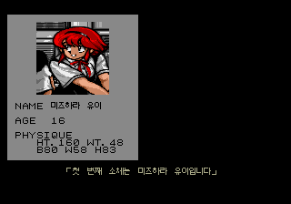
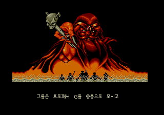
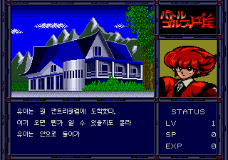
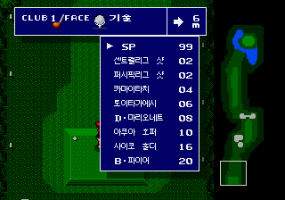

# 배틀 골퍼 유이 한국어 패치

메가드라이브 일본판 《배틀 골퍼 유이》(バトルゴルファー唯)용 비공식 한국어 패치입니다. 현재 배포 버전은 v1.0.0 정식판입니다.

## 다운로드

[패치 다운로드](https://github.com/kilk96/battle-golfer-yui-korean-patch/releases/tag/v1.0.0)에서 `BattleGolferYui_ko_v1.0.0.zip`을 받아 압축을 풀어 주세요. 페이지의 Assets(첨부 파일)에서 찾을 수 있습니다.

`Source code` 압축 파일은 받지 않으셔도 됩니다. 원본 게임 파일과 패치 적용이 끝난 게임 파일은 제공하지 않습니다.

## 적용 방법

1. 직접 보유하신 일본판 원본을 백업하고, 아래 지원 원본과 파일 확인의 크기·SHA-256을 확인해 주세요.
2. xdelta 3.2 이상을 지원하는 패치 프로그램에서 원본 파일과 `BattleGolferYui_ko_v1.0.0.xdelta`를 선택해 주세요.
3. 결과를 원본과 다른 이름의 `.md` 파일로 저장하고 아래 결과 SHA-256과 비교해 주세요.
4. 결과 파일을 메가드라이브 에뮬레이터에서 실행해 주세요. 자세한 명령은 ZIP 안의 `README.md`에 있습니다.

## 한글판 화면









## 번역·확인 범위

- 어드벤처 대사·행동 메뉴·오프닝과 엔딩 서사·인물 소개를 한글로 바꾸었습니다.
- 골프 명령·기술 목록·캐디 조언·결과창·점수표와 통계·퍼팅 안내 문장을 한글로 바꾸었습니다.
- 뮤직 박스 곡명·스태프 롤 직함·비밀번호 화면 안내도 한글로 바꾸었습니다.
- 원래 영문 라벨(`STATUS`, `LV`, `SP`, `PAR`, `HOLE` 등)과 그림으로 그려진 로고는 원본 그대로 두었습니다.
- 제작자가 엔딩까지 대사를 확인했습니다. 고르지 않은 대화 분기와 골프 패배·무승부 대화는 직접 확인하지 못했습니다.

## 실행과 저장

확인한 환경은 BizHawk 2.11.1의 GPGX 코어입니다. 패치를 적용하면 파일 크기가 512KB에서 1MB로 늘어납니다. 에뮬레이터의 순간 저장(세이브스테이트)은 일본판과 한글판 사이에, 또 패치 버전 사이에 호환되지 않습니다. 일본판에서 받은 비밀번호 사용은 따로 확인하지 않았습니다.

## 알려진 제한

- 실제 기기와 다른 에뮬레이터는 확인하지 못했습니다.
- 퍼팅 결과를 닫은 뒤 다음 진행이 원본보다 1프레임(약 1/60초) 늦습니다.
- 그림으로 그려진 로고와 일부 기술 아이콘(`止`·`火`)은 원본 그대로입니다. 골프 샷 막대의 `ワザ`는 `기술`로 다시 그렸습니다.

## 지원 원본과 파일 확인

| 항목 | 값 |
|---|---|
| 기종·판본 | 메가드라이브, Battle Golfer Yui (Japan) |
| 원본 형식 | 헤더 없는 롬(`.md` 또는 `.bin`) |
| 원본 크기 | 524,288바이트 |
| 원본 SHA-256 | `6f0eafce52aa8883f961d7828618c225174fa8454b02ee43c2b4ccdd3e3a2d38` |
| 결과 크기 | 1,048,576바이트 |
| 결과 SHA-256 | `a26549df412793c71bda65e43e9bc490e455fe2f65ad3a66802624f62eb330f9` |

SHA-256은 파일 내용이 같은지 확인하는 값입니다. 파일명보다 크기와 이 값이 일치하는지 확인해 주세요.

Windows PowerShell에서 다음 명령의 파일명을 바꾸어 원본과 결과를 각각 확인하실 수 있습니다.

```powershell
Get-FileHash -Algorithm SHA256 -LiteralPath '확인할파일.md'
```

## 문제 제보

[Issues에 제보해 주세요](https://github.com/kilk96/battle-golfer-yui-korean-patch/issues). 패치 버전, 에뮬레이터 이름·버전, 발생 장소와 직전 조작, 문제 화면을 함께 적어 주시면 도움이 됩니다. 원본·패치 적용 완료 게임 파일은 첨부하지 말아 주세요.

## 권리와 글꼴

원작사와 관계없는 팬 번역이며, 게임의 권리는 각 권리자에게 있습니다. 한글 글꼴은 달무리 글꼴(Apache License 2.0)을 게임용 비트맵으로 변환해 사용했으며, ZIP 안에 `FONT-NOTICE.txt`와 `LICENSE-dalmoori.txt`를 함께 넣었습니다.
